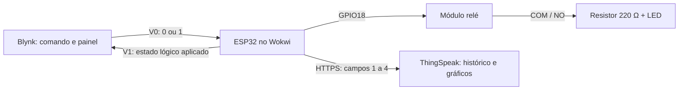
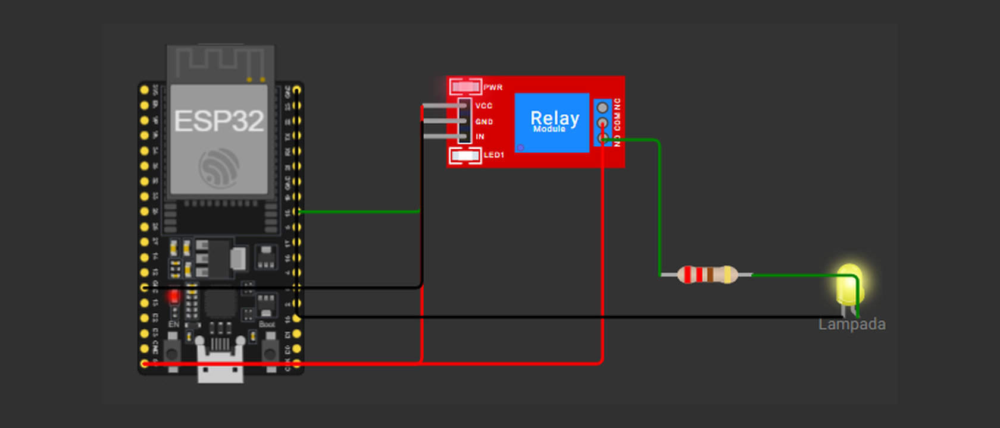

# Smart Light — ESP32 + Blynk IoT + ThingSpeak

Projeto acadêmico da disciplina **Desenvolvimento em Nuvem e IoT**, do **Centro Universitário Senac**. O objetivo é controlar uma lâmpada remotamente pelo Blynk e registrar indicadores de uso no ThingSpeak. No protótipo, o ESP32 e o circuito são simulados no Wokwi, e um LED representa a lâmpada. As duas plataformas de nuvem são serviços reais acessados pela internet.

**Estado do projeto:** os materiais do grupo, com evidências até **11/10/2026**, confirmam controle remoto e uma gravação no ThingSpeak com HTTP 200 e `entry_id=8`. A recuperação da última desconexão do Blynk permanece sem confirmação. Esta organização documental, revisada em **14/10/2026**, não representa um novo ensaio de integração.

> A inspeção do projeto público de origem encontrou um Auth Token Blynk e uma Write API Key ThingSpeak expostos. Esta cópia contém placeholders. **Revogar as credenciais antigas, gerar novas e remover os valores das cópias públicas**, inclusive do Wokwi. Apenas apagar uma chave do commit atual não desfaz sua exposição.

## Arquitetura e fluxo de dados



1. O Switch do Blynk envia 0 ou 1 em V0.
2. `BLYNK_WRITE(V0)` valida o comando; `aplicarEstado()` atualiza contadores e GPIO18.
3. O relé comuta o ramo que alimenta resistor e LED.
4. `enviarFeedback()` informa em V1 o estado lógico aplicado.
5. O loop prepara uma amostra, e uma tarefa FreeRTOS separada tenta enviá-la ao ThingSpeak.

**V0 é comando; V1 é feedback lógico.** Nenhum deles é um pino físico. V1 não mede luminosidade nem comprova que a carga acendeu. Não há integração direta entre Blynk e ThingSpeak: o ESP32 participa dos dois fluxos.

## Tecnologias e dependências

| Tecnologia | Papel |
| --- | --- |
| Wokwi + ESP32 DevKitC V4 | Simulação da placa e do circuito |
| C++ / Arduino Framework para ESP32 | Firmware |
| Blynk IoT / biblioteca Blynk | Comando V0, feedback V1 e conexão TLS |
| ThingSpeak / API HTTPS | Armazenamento dos quatro campos |
| Wi-Fi e NTP | Rede e ajuste do relógio para certificados |
| FreeRTOS | Tarefa HTTP e fila de amostras |

`libraries.txt` declara **Blynk**, única biblioteca externa adicionada ao projeto. `Arduino.h`, Wi-Fi, cliente TLS, HTTP e FreeRTOS vêm do ambiente Arduino-ESP32; `time.h` e `stdlib.h` são cabeçalhos padrão. A biblioteca Arduino ThingSpeak não é utilizada. As versões de Blynk e do core ESP32 não estão fixadas no material original; registrar versões em um próximo ensaio é uma pendência de reprodução.

## Componentes e conexões

| Quantidade | Componente | Uso |
| --- | --- | --- |
| 1 | ESP32 DevKitC V4 | Processamento e rede |
| 1 | Módulo relé de um canal | Comutação da carga |
| 1 | LED amarelo | Representação da lâmpada |
| 1 | Resistor de 220 Ω | Limitação de corrente em série com o LED |

| Origem | Destino |
| --- | --- |
| ESP32 GPIO18 | Relé IN |
| ESP32 5V | Relé VCC e COM |
| ESP32 GND.1 | Relé GND |
| Relé NO | Resistor terminal 1 |
| Resistor terminal 2 | LED A (ânodo) |
| LED C (cátodo) | ESP32 GND.2 |
| ESP32 TX / RX | RX / TX do monitor serial |

O diagrama usa `transistor="npn"`, e o firmware preserva **HIGH para ligar / LOW para desligar**, conforme os testes relatados pelo grupo. O resistor de 220 Ω **limita corrente; não é um divisor de tensão**. O sinal do GPIO é nominalmente 3,3 V, enquanto o módulo e o ramo da carga usam 5 V na simulação.

A montagem física ainda não foi validada. É necessário verificar a compatibilidade do módulo real com lógica de 3,3 V e sua alimentação. Este circuito acadêmico não é uma instalação pronta nem segura para ligação direta à rede residencial de 127/220 V. A demonstração permanece em simulação ou baixa tensão. Mais detalhes e a nota sobre a documentação do relé estão em [hardware](docs/hardware.md).



*Captura histórica, extraída do Guia do Grupo; não representa uma nova validação física ou da simulação.*

## Métricas do ThingSpeak

| Campo | Informação | Unidade / escopo |
| --- | --- | --- |
| 1 | Estado lógico da lâmpada | 0 ou 1 |
| 2 | Tempo acumulado ligada | horas desde o início desta execução |
| 3 | Número de acionamentos | transições OFF → ON nesta execução |
| 4 | Energia estimada, supondo potência constante de 9 W | kWh nesta execução |

```text
horas = tempoLigadaMs / 3.600.000
energia_kWh = (9 / 1.000) × horas
```

Por exemplo, três horas corresponderiam a **0,027 kWh**. Esse é um cálculo hipotético, não um resultado medido. A estimativa não inclui o consumo do ESP32, do relé ou da fonte. Não há sensor de energia nem cálculo automático do tempo ligado por dia.

O envio é programado a cada 30 s de simulação, sujeito às conexões e ao andamento das tarefas. A fila guarda somente a amostra pendente mais recente; não existe armazenamento local completo nem garantia de entrega de todas as amostras. Detalhes em [ThingSpeak](docs/thingspeak.md).

## Configurar credenciais

O arquivo compartilhável deve conservar estes valores:

```cpp
#define BLYNK_TEMPLATE_ID "COLE_SEU_BLYNK_TEMPLATE_ID"
#define BLYNK_TEMPLATE_NAME "Smart Light"
#define BLYNK_AUTH_TOKEN "COLE_SEU_BLYNK_AUTH_TOKEN"

const char* THINGSPEAK_WRITE_API_KEY = "COLE_SUA_THINGSPEAK_WRITE_API_KEY";
```

O Template ID identifica o modelo do Blynk. O Auth Token e a Write API Key são segredos. O firmware já reconhece o prefixo `COLE_`: sem token Blynk configurado, não inicia as conexões; sem chave ThingSpeak configurada, não cria a tarefa de envio. A rede de simulação usa `WiFi.begin("Wokwi-GUEST", "", 6)`, sem senha privada. [Wi-Fi do Wokwi](https://docs.wokwi.com/guides/esp32-wifi).

Para preservar a cópia versionável, preparar uma cópia de execução na pasta **`local/`**, ignorada pelo Git, ou fora do repositório. Preencher os valores apenas nela. O projeto atual não lê `.env` nem `secrets.h`; criar esses arquivos, sozinho, não configura o firmware. Essa separação por cópia evita alterar o mecanismo de configuração funcional.

O `.gitignore` não protege uma credencial colada no `sketch.ino` da raiz e não remove arquivos já rastreados. Antes de qualquer commit, conferir o conteúdo preparado, incluindo comentários, imagens e arquivos gerados. Não usar `git add -f` para incluir cópias privadas.

Os certificados `BEGIN CERTIFICATE` ao fim do sketch são certificados públicos de autoridades certificadoras, não chaves privadas. Foram preservados. TLS continua habilitado.

## Executar no Wokwi

1. Preparar um projeto ESP32 DevKitC V4 no Wokwi. O [projeto de origem](https://wokwi.com/projects/477087443198743553) serve como referência, mas os valores de credenciais ali encontrados devem ser revogados e removidos antes de reutilizar ou compartilhar a cópia.
2. Copiar o conteúdo dos três arquivos para as abas correspondentes: `sketch.ino`, `diagram.json` e `libraries.txt`. Não colar o JSON dentro do sketch.
3. Confirmar que **Blynk** aparece no Library Manager. As bibliotecas do core ESP32 não precisam ser adicionadas separadamente. [Bibliotecas no Wokwi](https://docs.wokwi.com/guides/libraries).
4. Fazer primeiro um ensaio sem credenciais: na cópia de execução, usar `TESTE_LOCAL = true` e `ATIVAR_THINGSPEAK = false`. Iniciar a simulação e conferir o monitor serial a 115200 baud. O programa deve alternar a saída a cada 2 s de simulação. Esse é um resultado esperado a verificar.
5. Configurar o [Blynk](docs/blynk.md) com V0/V1 inteiros 0–1 e o [canal ThingSpeak](docs/thingspeak.md) com os quatro campos.
6. Para testar as nuvens, usar credenciais novas e exclusivas de teste em uma cópia com privacidade verificada. Não salvar código com segredos em projeto público ou tratá-lo como privado por não divulgar o link. Se não houver ambiente privado adequado no Wokwi, permanecer no teste local sem chaves até preparar um ambiente de execução privado.
7. Testar Blynk com `TESTE_LOCAL = false` e `ATIVAR_THINGSPEAK = false`. Confirmar Online, comando V0, GPIO18 e retorno V1.
8. Habilitar `ATIVAR_THINGSPEAK = true`, mantendo `TESTE_LOCAL = false`. Aguardar Wi-Fi, horário NTP e o resultado do envio HTTPS. Só considerar gravação aceita com HTTP 200 **e** identificador positivo.

As flags entregues preservam o modo original (`false` / `true`); com os placeholders, a integração exige configuração. As instruções acima descrevem testes a executar, não testes realizados nesta revisão. O gateway público do Wokwi é um serviço compartilhado; usar somente dados de demonstração. A documentação do Wokwi diferencia os gateways e suas condições de privacidade no [guia de rede](https://docs.wokwi.com/guides/esp32-wifi).

## Testes e evidências

Sem reiniciar entre ações, o roteiro integrado é ON por 60 s de simulação → OFF por cerca de 40 s → ON por cerca de 40 s. Conferir V0, GPIO18 e V1; verificar que o tempo cresce em ON e para em OFF, e que a contagem aumenta apenas ao ligar a partir de OFF. Esperar uma gravação positiva após cada fase.

| Resultado documentado pelo grupo em 11/10/2026 | Alcance da evidência |
| --- | --- |
| Conexão Blynk, `Ready`, WiFi=ON e Blynk=ON | Houve conexão naquele ensaio |
| ON → OFF → ON, GPIO18 e V1 coerentes | Controle lógico remoto observado |
| Contagem 1 → 2 no segundo ON | Contagem de acionamentos observada |
| Tempo permaneceu em 0,004797 h durante OFF | Acumulado parou enquanto desligada |
| HTTP 200 e `entry_id=8`; captura com 8 entradas | Uma gravação foi confirmada; 8 não significa oito acionamentos |
| Última captura Blynk Offline e tentativa TLS | Recuperação posterior não comprovada |

O [registro de testes](docs/testes.md) contém as capturas, sua proveniência, o trecho selecionado do log, os procedimentos e as verificações estáticas desta revisão. Não foi executada nova simulação, integração com as nuvens ou montagem física. Não havia toolchain ESP32 disponível para compilar localmente.

## Limitações e próximos passos

| Limitação atual | Próximo passo proposto, ainda não implementado |
| --- | --- |
| Credenciais expostas no projeto de origem | Revogar, substituir e retirar das cópias públicas |
| Última reconexão sem resultado posterior | Registrar retorno Online, sincronização de V0 e novos comandos/gravações |
| V1 informa apenas estado lógico | Avaliar sensor de luz ou corrente, caso confirmação física seja requisito |
| Contadores em RAM zeram ao reiniciar | Projetar persistência e identificação das sessões |
| Sem totais diários automáticos | Tratar calendário, fuso, reinícios, lacunas e intervalos entre dias |
| Energia estimada a 9 W | Validar instrumentação se houver requisito de medição real |
| Fila de uma amostra, sem reenvio persistente | Avaliar política de armazenamento e entrega se perdas forem inaceitáveis |
| Reconexão Blynk pode ocupar a tarefa principal | Investigar latência e sincronização NTP com logs antes de mudar o fluxo |
| Versões de dependências não registradas | Registrar e fixar versões após um ensaio reproduzível |
| Montagem física pendente | Validar componentes reais e interfaces em baixa tensão |
| Enunciado original cita ESP8266 | Confirmar com o professor o aceite do ESP32 |

Nenhuma dessas evoluções foi incorporada à lógica do firmware nesta organização. As únicas mudanças no sketch foram dois segredos e o identificador do template substituídos por placeholders.

## Organização e estudo do grupo

```text
smart-light-iot/
├── README.md
├── sketch.ino
├── diagram.json
├── libraries.txt
├── .gitignore
├── docs/
│   ├── arquitetura.md
│   ├── hardware.md
│   ├── firmware.md
│   ├── blynk.md
│   ├── thingspeak.md
│   └── testes.md
└── assets/
    └── screenshots/
```

O repositório do projeto é [GuilhermeSerafim/smart-light-iot](https://github.com/GuilhermeSerafim/smart-light-iot). Os PDFs e o HTML originais permanecem como fontes locais de consulta, ignorados pelo Git. As capturas selecionadas foram extraídas desses materiais e revisadas; não são novas evidências de execução.

Para os cinco integrantes, uma divisão de estudo possível é: arquitetura; hardware; firmware; nuvens; testes e limitações. Todos devem conseguir explicar o percurso completo do comando e a diferença entre medição física e estado lógico.

| Documento | Pergunta que ajuda a responder |
| --- | --- |
| [Arquitetura](docs/arquitetura.md) | Como comando, atuação e histórico se relacionam? |
| [Hardware](docs/hardware.md) | De onde vem a energia e qual é a função de cada conexão? |
| [Firmware](docs/firmware.md) | Como o código conta, comanda, conecta e envia dados? |
| [Blynk](docs/blynk.md) | Como configurar e interpretar V0/V1? |
| [ThingSpeak](docs/thingspeak.md) | O que cada campo significa e como confirmar uma escrita? |
| [Testes](docs/testes.md) | O que já foi observado e o que ainda precisa ser demonstrado? |

## Referências técnicas

- [Wokwi — rede Wi-Fi ESP32](https://docs.wokwi.com/guides/esp32-wifi).
- [Wokwi — módulo relé](https://docs.wokwi.com/parts/wokwi-relay-module), com a ressalva descrita em hardware.
- [Wokwi — bibliotecas Arduino](https://docs.wokwi.com/guides/libraries).
- [Espressif — Arduino-ESP32 e GPIO](https://docs.espressif.com/projects/arduino-esp32/en/latest/api/gpio.html).
- [Espressif — FreeRTOS](https://docs.espressif.com/projects/esp-idf/en/stable/esp32/api-reference/system/freertos_idf.html).
- [Blynk — pinos virtuais](https://docs.blynk.io/en/blynk-library-firmware-api/virtual-pins), [sincronização](https://docs.blynk.io/en/blynk-library-firmware-api/state-syncing) e [conexões](https://docs.blynk.io/en/blynk-library-firmware-api/connection-management).
- [MathWorks — escrita no ThingSpeak](https://www.mathworks.com/help/thingspeak/writedata.html) e [configuração do canal](https://www.mathworks.com/help/thingspeak/channel-settings.html).

## Histórico de alterações

A organização inicial foi registrada em cinco commits por responsabilidade. Eles representam a importação e a documentação do protótipo recebido, não a cronologia do desenvolvimento original ou novos ensaios:

| Etapa | Conteúdo |
| --- | --- |
| Proteção do repositório | `.gitignore`, cópias privadas, fontes locais e artefatos |
| Importação do firmware | Sketch com placeholders, diagrama, bibliotecas e descrição do firmware |
| Arquitetura e circuito | Fluxos, conexões e conceitos elétricos |
| Evidências e testes | Capturas revisadas, proveniência, resultados e verificações pendentes |
| Guias de reprodução | README, configuração Blynk e ThingSpeak |

Cada mensagem de commit segue Conventional Commits e registra o motivo e a validação da etapa. Para consultar os identificadores, examinar a última alteração ou acompanhar o histórico do firmware:

```bash
git log --reverse --format="%h %s"
git show --stat HEAD
git log --oneline -- sketch.ino
```

Os cinco commits iniciais seguem essa ordem para manter suas referências locais disponíveis e foram publicados sem squash. Um commit documental posterior registra a publicação autorizada no GitHub. Alterações seguintes devem continuar em commits separados por responsabilidade, com motivo e validação descritos.

## Licença

A licença ainda não foi definida pelos responsáveis pelo projeto. Por esse motivo, não foi criado um arquivo `LICENSE`; não se deve presumir uma licença de uso ou redistribuição.
