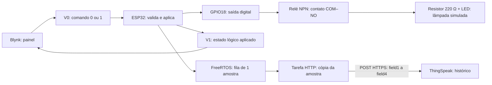

# Arquitetura do Smart Light

O Smart Light é um protótipo acadêmico de iluminação conectada. O Blynk recebe o comando do usuário; o ESP32 executa o firmware; o relé comuta um LED que representa a lâmpada; o ThingSpeak guarda amostras de uso. O circuito está simulado no Wokwi, com acesso às plataformas de nuvem. A montagem e seus limites elétricos estão em [hardware.md](hardware.md).

O dispositivo implementado é o **ESP32**, em substituição ao ESP8266 previsto no enunciado. O aceite dessa substituição pelo professor permanece pendente.

## Percurso do comando e dos dados

V0 e V1 são canais virtuais, sem correspondência direta com os pinos físicos. Neste projeto, V0 recebe comandos e V1 devolve o estado lógico. O valor `1` significa ligado; não representa 1 volt. O GPIO físico utilizado é o 18. A distinção entre canais virtuais e GPIO e as funções de envio e recepção são descritas na [documentação oficial do Blynk](https://docs.blynk.io/en/blynk-library-firmware-api/virtual-pins).

Uma sequência de acionamento segue estes passos:

1. O Switch do painel envia `1` por V0.
2. `BLYNK_WRITE(V0)` aceita apenas `0` ou `1` e chama `aplicarEstado()`.
3. O firmware contabiliza o intervalo anterior, incrementa o contador apenas em uma transição desligada → ligada e aplica `HIGH` no GPIO18.
4. Na configuração NPN/HIGH preservada do projeto, o relé comuta a carga ligada ao contato NO.
5. `enviarFeedback()` transmite `V1=1` quando o Blynk está conectado.
6. O agendamento periódico prepara uma amostra para envio ao ThingSpeak.

V1 informa a decisão do firmware. Não há sensor de luminosidade, corrente ou posição do contato que confirme fisicamente a atuação. O indicador Online/Offline informa a conexão e deve ser interpretado separadamente.

## Organização do firmware

| Elemento | Responsabilidade no código |
| --- | --- |
| `setup()` | Inicializa Serial em 115200 bit/s, configura GPIO18 como saída e começa com `LOW`, desligado. No modo nuvem, inicia Wi-Fi, Blynk e a preparação da tarefa ThingSpeak. |
| `loop()` | Atualiza tempo, atende conexões, agenda amostras e imprime o diagnóstico periódico. |
| `aplicarEstado()` | Fecha a contabilização do estado anterior, identifica a transição OFF → ON e atualiza estado e GPIO. |
| `BLYNK_CONNECTED()` | Solicita o último V0 salvo com `Blynk.syncVirtual(V0)`. |
| `tarefaThingSpeak()` | Recebe uma cópia de `Amostra`, executa o POST HTTPS e verifica a resposta. |

A resposta à sincronização de V0 passa pelo mesmo callback que trata um comando comum; somente depois de aplicar a saída o firmware envia V1. Esse funcionamento de `syncVirtual()` consta na [documentação do Blynk](https://docs.blynk.io/en/blynk-library-firmware-api/virtual-pins#blynk.syncvirtual-vpin).

## Duas tarefas e uma fila curta

A tarefa principal é a única que modifica o estado da lâmpada, o GPIO e a comunicação Blynk. A tarefa HTTP recebe uma estrutura com estado, horas, acionamentos e energia estimada. A fila copia os valores; a tarefa HTTP não recebe acesso direto às variáveis de estado para alterá-las.

`xQueueCreate(1, sizeof(Amostra))` cria uma fila com **uma posição**. O produtor usa `xQueueOverwrite()`: uma nova amostra substitui a que ainda estiver aguardando. Essa operação corresponde ao uso de fila de comprimento um descrito pela [referência oficial do FreeRTOS](https://www.freertos.org/Documentation/02-Kernel/04-API-references/06-Queues/11-xQueueOverwrite).

O firmware agenda amostras a cada 30 segundos de execução, quando há Wi-Fi e a fila foi criada. Após cada tentativa de envio, a tarefa HTTP descansa 20 segundos; essa pausa pertence a ela. A fila mantém somente a amostra pendente mais recente, sem histórico local de reenvios. Uma falha de envio descarta a amostra processada, e amostras pendentes podem ser sobrescritas.

Separar o HTTPS reduz a espera no fluxo de comandos. Ainda existem recursos compartilhados, e uma tentativa de conexão Blynk pode atrasar temporariamente o fluxo principal. O código usa `Blynk.connect(30000)`; esse argumento limita a espera do protocolo, mas não garante um limite total para DNS e TLS.

## Telemetria e significado das métricas

| Campo ThingSpeak | Valor enviado | Unidade e limite |
| --- | --- | --- |
| `field1` | Estado lógico aplicado | `0` ou `1`; não é medição física. |
| `field2` | Tempo acumulado ligada | Horas nesta sessão de execução. |
| `field3` | Acionamentos acumulados | Quantidade de transições OFF → ON nesta sessão. |
| `field4` | Energia estimada | kWh, calculados com potência hipotética constante de 9 W. |

As fórmulas usam ponto flutuante: `horas = static_cast<double>(tempoLigadaMs) / 3600000.0` e `energiaKWh = (9.0 / 1000.0) * horas`. A potência de 9 W representa uma lâmpada hipotética; não é o consumo medido do LED, do relé ou do ESP32. Reiniciar a execução zera os acumulados. Os dados representam **sessões, não totais diários automáticos**. Uma análise por dia exigiria tratar datas, fuso, reinícios e lacunas; somar valores acumulados repetiria tempo já contado.

O POST usa `https://api.thingspeak.com/update`, corpo `application/x-www-form-urlencoded` com os quatro campos e a chave privada no cabeçalho `THINGSPEAKAPIKEY`. A gravação só é confirmada pelo firmware quando há HTTP 200 e identificador de entrada inteiro positivo; corpo `0` indica rejeição. A API oficial documenta o cabeçalho e esse retorno em [MathWorks — Write Data](https://www.mathworks.com/help/thingspeak/writedata.html).

## Rede, confiança e interrupções

O ESP32 conecta-se à rede virtual `Wokwi-GUEST`. O Blynk usa a biblioteca SSL; o ThingSpeak usa `WiFiClientSecure` com certificados de autoridades públicas. O código não desativa a validação com `setInsecure()`. NTP fornece o relógio necessário à verificação temporal dos certificados; o envio ThingSpeak aguarda um horário válido. Certificados públicos não são credenciais; Auth Token e Write API Key devem permanecer privados.

Sem internet, novos comandos remotos deixam de chegar e a saída mantém o último estado enquanto o firmware continua rodando. Após um reinício, o GPIO começa desligado, os contadores zeram e a conexão Blynk solicita o V0 salvo, que pode religar a saída.

## Evidência disponível

O guia do grupo, com evidências até 11/10/2026, registra ON/OFF com GPIO18 e V1 coerentes e uma escrita `HTTP=200 | entry_id=8`. O último painel Blynk apresentado estava Offline e o log terminou em tentativa de reconexão. Esses registros anteriores não comprovam estabilidade contínua nem estabelecem que o ThingSpeak causou a desconexão. Esta documentação foi produzida pela leitura do material fornecido; **nenhum novo teste foi executado**.
